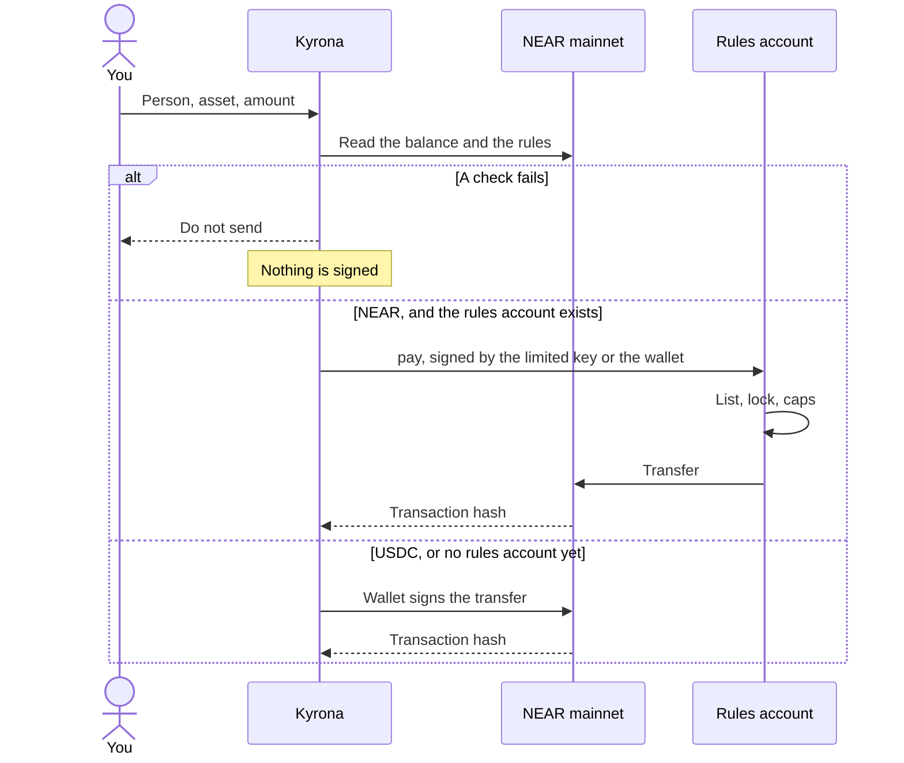

<p align="center">
  
</p>

<h1 align="center">Kyrona</h1>

<p align="center">
  Spending limits before you send NEAR or USDC.
</p>

<p align="center">
  <a href="https://kyrona.vercel.app"></a>
  
  <a href="https://nearblocks.io/address/rules.sithunyein.near"></a>
  <a href="https://github.com/thesithunyein/kyrona/actions/workflows/ci.yml"></a>
  <a href="https://github.com/thesithunyein/kyrona/actions/workflows/judge.yml"></a>
  <a href="LICENSE"></a>
</p>

<p align="center">
  <a href="https://kyrona.vercel.app">Open the desk</a>
  ·
  <a href="SECURITY.md">Security</a>
  ·
  <a href="CODE_OF_CONDUCT.md">Code of conduct</a>
  ·
  <a href="LICENSE">License</a>
</p>

Kyrona is a spending desk for a NEAR account. You name who you pay, set a cap per payment and a cap per day, and lock spending when you want everything to stop. For NEAR, those rules live on `rules.sithunyein.near`. A payment has to call `pay`. The contract checks the list, the lock, and the caps, and only then sends the NEAR.

The payment to open first is [0.01 NEAR sent by the agent script to `kyawminthat.near`](https://nearblocks.io/txns/2s7qQnyTwYmTiJGka5XqKxk2WsU9pcCSLJvKy6qSKdu2). That account was not created by this project. The script holds a key that can only call `pay`.


## The problem

Sending NEAR is easy. Sending the wrong amount, to an account you did not mean, is also easy. A wallet asks you to approve a transaction. It does not know your daily budget, your list of people, or that you wanted spending frozen.

Kyrona sits in front of that approval. Once the rules are on their own account, `pay` still checks them even if the page is skipped.

NEAR lets a function-call key be limited to one method on one contract. The payment program holds a key scoped to `pay` on the rules account, so it cannot transfer NEAR, add a key, or deploy code. That limit is enforced by the chain, not by the page.

## How a payment moves



The checks, in order:

| Check | Pass means |
|---|---|
| Spending lock | The desk is open |
| Asset | NEAR or USDC is allowed |
| Recipient | The account is on your list |
| Per payment | The amount is within that cap |
| Today | Today’s total would still be within the daily cap |
| Balance | The chain balance covers it |

On the rules account, `pay` repeats the lock, the list, and both caps. USDC does not go through `pay`.

## Check it yourself, no wallet

```
npm run judge
```

This starts a local NEAR node (nearcore 2.14.0, downloaded on the first run), deploys `public/kyrona.wasm` the same way the desk does, and gives an agent a key that may only call `pay`. Then the agent tries to break the rules. No wallet, no keys and no funds are needed. It needs Node 20 or newer on Linux x86_64 or Apple Silicon macOS; on Windows, run it in WSL.

What you should see (the run exits 1 if any line differs):

| The agent tries | Result |
|---|---|
| pay 1 NEAR to an account on the list | paid |
| pay 0.5 NEAR to a stranger, as a prompt-injected invoice asked | refused by the contract: `Not on the list` |
| pay 2.5 NEAR, over the 2 NEAR per-payment cap | refused by the contract: `Over the per-payment cap` |
| pay 1.5 NEAR, then 1 NEAR more the same day | the first is paid; the second is refused: `Over the daily cap` |
| transfer NEAR directly with its own key | refused by NEAR: `RequiresFullAccess` |
| call `set_rules` to add the stranger to the list | refused by NEAR: `MethodNameMismatch` |
| add a full-access key for itself | refused by NEAR: `RequiresFullAccess` |
| pay after the owner locks spending | refused by the contract: `Spending is locked` |

At the end the run checks the balances: the listed account received 2.5 NEAR, the stranger received nothing, and the contract records 2.5 NEAR spent. The [Judge run](https://github.com/thesithunyein/kyrona/actions/workflows/judge.yml) workflow runs the same command on a clean machine on every push. The script is [`judge/run.mjs`](judge/run.mjs).

## Proof

Open this first: [0.01 NEAR sent by `scripts/agent.mjs` to `kyawminthat.near`](https://nearblocks.io/txns/2s7qQnyTwYmTiJGka5XqKxk2WsU9pcCSLJvKy6qSKdu2).

That program is not the website. Before paying, it was refused for `outside.near`, and it was refused when it tried to transfer. The same limited key then called `pay`. `kyawminthat.near` now holds 0.02 NEAR: 0.01 from the page, then 0.01 from the script. The earlier page payment is [5QP4MsGyTzHjMUSPoMGC8bdEkz6dhsj9YL6j2Y2NUTLR](https://nearblocks.io/txns/5QP4MsGyTzHjMUSPoMGC8bdEkz6dhsj9YL6j2Y2NUTLR).

`rules.sithunyein.near` is on mainnet. The owner is `sithunyein.near`. The list is `sithunyein.near`, `vendor.sithunyein.near`, and `kyawminthat.near`. The caps are 20 NEAR per payment and 50 NEAR a day. The lock is open. About 0.74 NEAR stays locked for the code. The rest can be paid out. The contract has recorded 0.04 NEAR spent.

| What the limited key tried | Result |
|---|---|
| `scripts/agent.mjs` paid 0.01 NEAR to `kyawminthat.near` | [2s7qQnyTwYmTiJGka5XqKxk2WsU9pcCSLJvKy6qSKdu2](https://nearblocks.io/txns/2s7qQnyTwYmTiJGka5XqKxk2WsU9pcCSLJvKy6qSKdu2). Signed by the separate program, not by the page. The key was `ed25519:HVAdkwtDzULFkPmKZNnU5XYGrLXBbmmYcEyLKzQ4n11R`, which can only call `pay`. |
| `pay` to `outside.near` | Refused. The contract says that account is not on the list. |
| A direct transfer | Refused by the protocol. The key may only call `pay`. |
| `pay` 0.01 NEAR to `sithunyein.near` | [EhiB269WNE8W823fJYvwRvB1ei9yHPXs6DrrbMYia9jd](https://nearblocks.io/txns/EhiB269WNE8W823fJYvwRvB1ei9yHPXs6DrrbMYia9jd). An earlier check. The receiver is the owner. |
| `pay` 0.01 NEAR to `vendor.sithunyein.near` | [2aMMe5xPv8DWayTS2wfWxfMD4fTPFWhfMGmYYVn61Lyk](https://nearblocks.io/txns/2aMMe5xPv8DWayTS2wfWxfMD4fTPFWhfMGmYYVn61Lyk). An earlier check. This project created that account. |

The demo shows the allowlist refusal and the payment. The lock and the daily cap are not in the video; both are part of the same `pay` call and are covered by tests in [`contract/src/lib.rs`](https://github.com/thesithunyein/kyrona/blob/main/contract/src/lib.rs).

## Use it

The live desk is [kyrona.vercel.app](https://kyrona.vercel.app). Meteor is a Chrome extension. MyNearWallet works in Firefox.

To see the proof without connecting a wallet:

1. Open [the refused payment](https://nearblocks.io/txns/BZziRt2321pBRuaWduREXmYLLFHQHshQmBi4H3cyR7fg). The status is failed, and the contract says the account is not on the list.
2. Open [the payment from the script](https://nearblocks.io/txns/2s7qQnyTwYmTiJGka5XqKxk2WsU9pcCSLJvKy6qSKdu2). `scripts/agent.mjs` called `pay`, and 0.01 NEAR arrived at `kyawminthat.near`.

To use the desk:

1. Choose **Connect**, then Meteor or MyNearWallet.
2. On Desk, choose **Refresh**. The figures come from the chain. Meteor may hide about 0.2 NEAR as its own gas reserve. The desk shows the full balance.
3. On Rules, add each account you pay. An account that is not on the list cannot be paid. Set the caps. **Locked** in the header stops every payment. **Open** means spending is allowed.
4. On Pay, choose the person, NEAR or USDC, and the amount. Choose **Check against my rules**.
5. **Do not send** means a check failed. Nothing is signed. **Save this stop** writes the refusal in the ledger.
6. **Safe to send** means every check passed. **Send on NEAR** opens the wallet, unless the rules are already on the account and this browser holds the limited key. Then the limited key calls `pay` and the wallet does not have to sign that payment.
7. On Rules, **Put the rules on chain** creates `rules.<your account>` and stores the list, the caps, and the lock there. Meteor will not deploy contract code, so that one signature can be made in the page. The key is not saved. About 0.79 NEAR moves. About 0.74 stays locked for the code. The rest can be paid out. **Add a limited key** creates a key that can call `pay` on that account and nothing else. **Try to break it** asks that key to pay an unknown account, and to transfer NEAR directly. Both must fail. **Update the rules** writes a new list or new caps. That one does open the wallet.
8. **1. Create the other account** makes `vendor.<your account>` and puts it on the list. The new account can receive. It has no key, because Meteor blocks adding one. On this deployment that account is `vendor.sithunyein.near`. It is a test receiver, not the proof.
9. **2. Add 0.2 NEAR** moves spare NEAR onto the rules account so `pay` can run more than once.
10. **3. Run the agent** on the page uses the limited key in this browser. It is not the program in `scripts/agent.mjs`. The page button pays the vendor account. The payment that matters was signed by the script: [2s7qQnyTwYmTiJGka5XqKxk2WsU9pcCSLJvKy6qSKdu2](https://nearblocks.io/txns/2s7qQnyTwYmTiJGka5XqKxk2WsU9pcCSLJvKy6qSKdu2).

**Save to my account** on Rules writes the limits and the ledger to `social.near`, signed by you, so the same wallet can load them in another browser. Until you do that, they stay on this phone or computer.

## What this is not

- Kyrona does not custody a pool of funds. The rules account is a sub-account you still control. Your full-access key is on it, so you can move that NEAR without calling `pay`. The limited key cannot.
- Before the rules are on the account, they are enforced in the page. A transfer started directly in the wallet is not checked.
- USDC is checked in the page and sent with `ft_transfer`. It does not pass through `pay`.
- There is no private computation. `scripts/agent.mjs` is a separate program. It reads a limited key from the environment and refuses a full-access key. Its payment is [2s7qQnyTwYmTiJGka5XqKxk2WsU9pcCSLJvKy6qSKdu2](https://nearblocks.io/txns/2s7qQnyTwYmTiJGka5XqKxk2WsU9pcCSLJvKy6qSKdu2). The key is not in this repository.
- The rules account can pay out only the NEAR that is not locked for code. A large cap does not create a large balance.

## The other project

This is the first project. The second is [Hasp](https://github.com/thesithunyein/hasp), a one-shot swap to USDC that refuses an amount over 0.02 NEAR before it asks for a quote. Hasp has no contract and no key. It does not use `rules.sithunyein.near`, the limited key, or this desk. The two share no product code. Both repositories started from the same Grok App Builder shell, so those generated files are identical in each; the contract, the desk and the agent here are Kyrona's alone.

## In the code

The desk is the product. The contract is the part a skipped page cannot bypass.

```text
kyrona
├── src
│   ├── routes
│   │   ├── index.tsx              Desk, Pay, Rules, Ledger
│   │   └── __root.tsx             Document, icon, theme
│   ├── lib
│   │   └── kyrona
│   │       ├── engine.ts          The six checks and the daily total
│   │       ├── policy.ts          The rules account, and reading it back
│   │       ├── chain.ts           Mainnet balance and USDC units
│   │       ├── wallet.ts          Wallet signature, deploy, limited key, pay
│   │       ├── account-desk.ts    Local desk and the social.near copy
│   │       ├── store.ts           Rules, balances, and the ledger
│   │       └── session.ts         Which account is connected
│   ├── router.tsx
│   ├── routeTree.gen.ts
│   └── styles.css
├── scripts
│   └── agent.mjs                  A separate program. Limited key only. The key is not stored here
├── contract
│   ├── Cargo.toml                 near-sdk 5.17, so the wasm links on current mainnet
│   └── src/lib.rs                 list, caps, lock, pay
├── public
│   ├── kyrona.wasm                The contract the desk deploys, 73,784 bytes
│   ├── logo.png
│   ├── favicon.png
│   ├── favicon.svg
│   └── og.jpg
├── docs
│   └── desk.png                   The desk, before a wallet is connected
├── README.md
├── SECURITY.md
├── CODE_OF_CONDUCT.md
├── LICENSE
├── package.json
├── tsconfig.json
├── vite.config.ts
└── vercel.json
```

A newer SDK imported host functions this network does not provide. The contract is pinned to `near-sdk` 5.17 so `pay` can start. A transfer is decided in `engine.ts`, and signed in `wallet.ts`. On chain, `contract/src/lib.rs` decides it again.

## Built with

Written for this hackathon, from 1 November 2026. The app shell (TanStack Start, React, Vite, the auth and preview wiring under `src/lib/auth`, `src/lib/app-data`, `server/` and most of `scripts/`) came from a Grok App Builder export and is in the first commit, `8ba0acc`. Everything Kyrona does is new: `contract/`, `src/lib/kyrona/`, `src/routes/index.tsx` and `scripts/agent.mjs`. Parts of the code were written with AI assistance. Wallets are Meteor and MyNearWallet through `@near-wallet-selector`. The contract is Rust and `near-sdk` 5.17, pinned so it links on current mainnet. `scripts/agent.mjs` uses `@near-js`.

## Run the agent

`scripts/agent.mjs` is not the website. It signs with a limited key supplied at runtime. If that key can do more than call `pay`, the script stops.

```sh
KYRONA_LIMITED_KEY='ed25519:...' npm run agent
```

Do not commit the key. The script then refuses `outside.near`, refuses a direct transfer, and sends 0.01 NEAR to `kyawminthat.near`.

## Run it locally

```sh
npm install
npm run dev
```

The dev server is [http://127.0.0.1:8080](http://127.0.0.1:8080).

## Security

Report a vulnerability privately. Do not open a public issue for a live exploit. The threat model, what is signed, and what is not enforced on chain are in [SECURITY.md](SECURITY.md).

## Conduct

Be decent to the people using and building this. [CODE_OF_CONDUCT.md](CODE_OF_CONDUCT.md).

## License

[MIT](LICENSE). Copyright 2026 Sithu Nyein.
