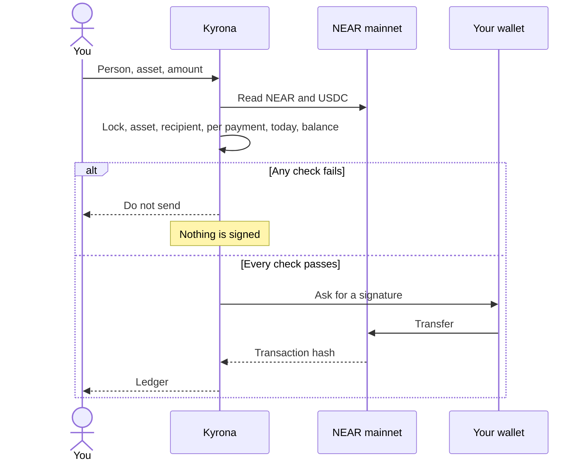

<p align="center">
  
</p>

<h1 align="center">Kyrona</h1>

<p align="center">
  Spending limits before you send NEAR or USDC.
</p>

<p align="center">
  <a href="https://kyrona.vercel.app"></a>
  
  
  <a href="LICENSE"></a>
</p>

<p align="center">
  <a href="https://kyrona.vercel.app">Open the desk</a>
  ·
  <a href="SECURITY.md">Security</a>
  ·
  <a href="CODE_OF_CONDUCT.md">Code of conduct</a>
  ·
  <a href="LICENSE">License</a>
</p>

Kyrona is a spending desk for a NEAR account. You name who you pay, set a cap per payment and a cap per day, and lock spending when you want everything to stop. Kyrona reads the real balance, runs those rules, and only then asks your wallet to sign. A failed check never opens a transfer.

## The problem

Sending NEAR is easy. Sending the wrong amount, to an account you did not mean, is also easy. A wallet asks you to approve a transaction. It does not know your daily budget, your list of people, or that you wanted spending frozen.

Kyrona sits in front of that approval.

## How a payment moves



The checks, in order:

| Check | Pass means |
|---|---|
| Spending lock | The desk is open |
| Asset | NEAR or USDC is allowed |
| Recipient | The account is on your list |
| Per payment | The amount is within that cap |
| Today | Today’s total would still be within the daily cap |
| Balance | The chain balance covers it |

## Proof

This is a real transfer, signed by the account that holds the funds. It is not a simulated hash.

[0.01 NEAR from `sithunyein.near` to `sithunyein.near`](https://nearblocks.io/txns/DmCpHhv7quFAzcB7dNwkSrdGXrPENMWJQqUCzTF8GC22)

The desk recorded that hash after the wallet confirmed it. A payment of 1 NEAR on the same account was refused first, because the balance was lower. No signature was requested for the refusal.

## Use it

The live desk is [kyrona.vercel.app](https://kyrona.vercel.app). Use Chrome and the [Meteor](https://meteorwallet.app) extension.

1. Choose **Connect**, then Meteor.
2. On Desk, choose **Refresh**. The figures come from the chain. Meteor may hide about 0.2 NEAR as its own gas reserve. The desk shows the full balance.
3. On Rules, add each account you pay. An account that is not on the list cannot be paid. Set the caps. **Locked** in the header stops every payment. **Open** means spending is allowed.
4. On Pay, choose the person, NEAR or USDC, and the amount. Choose **Check against my rules**.
5. **Do not send** means a check failed. Nothing is signed. **Save this stop** writes the refusal in the ledger.
6. **Safe to send** means every check passed. **Send on NEAR** opens the wallet, unless the rules are already on the account and this browser holds the limited key. Then the limited key calls `pay` and the wallet does not have to sign that payment.
7. On Rules, **Put the rules on chain** creates `rules.<your account>` and stores the list, the caps, and the lock there. Meteor will not put code on the main account. About 0.79 NEAR moves. 0.74 stays locked for the code. 0.05 can be paid out. **Add a limited key** creates a key that can call `pay` on that account and nothing else. **Try to break it** asks that key to pay an unknown account, and to transfer NEAR directly. Both must fail.

**Save to my account** on Rules writes the limits and the ledger to `social.near`, signed by you, so the same wallet can load them in another browser. Until you do that, they stay on this phone or computer.

## What this is not

Say this plainly, because it is the boundary of the product.

- Kyrona does not hold the full-access key and does not custody a separate pool of funds.
- Before the rules are on the account, they are enforced in the page. A transfer started directly in the wallet is not checked.
- After **Put the rules on chain**, `pay` on the account enforces the list, the lock, and the caps. A normal transfer from Meteor still skips `pay`.
- The limited key can call only `pay`. It cannot transfer NEAR, add a key, or deploy code. Its gas allowance is 0.05 NEAR. The secret for that key stays in this browser.
- There is no cross-chain swap and no private computation.
- USDC can be sent only when the account actually holds USDC. USDC does not go through `pay`.

## In the code

The desk is the product. The rest of the repository is the host that builds and serves it.

```text
kyrona
├── src
│   ├── routes
│   │   ├── index.tsx              Desk, Pay, Rules, Ledger
│   │   └── __root.tsx             Document, icon, theme
│   ├── lib
│   │   └── kyrona
│   │       ├── engine.ts          The six checks and the daily total
│   │       ├── chain.ts           Mainnet balance, USDC units, storage deposit
│   │       ├── wallet.ts          Meteor and MyNearWallet, then the signature
│   │       ├── account-desk.ts    Local desk and the social.near copy
│   │       ├── store.ts           Rules, balances, and the ledger
│   │       └── session.ts         Which account is connected
│   ├── router.tsx
│   ├── routeTree.gen.ts
│   └── styles.css
├── contract
│   ├── Cargo.toml
│   └── src/lib.rs                 The on-account rules: list, caps, lock, pay
├── public
│   ├── kyrona.wasm                The contract the desk deploys, 78,569 bytes
│   ├── logo.png
│   ├── favicon.png
│   ├── favicon.svg
│   └── og.jpg
├── README.md
├── SECURITY.md
├── CODE_OF_CONDUCT.md
├── LICENSE
├── package.json
├── tsconfig.json
├── vite.config.ts
└── vercel.json
```

The host also contains the framework files that start the app, including auth and preview helpers under `src/lib`. They are not part of a payment. A transfer is decided in `engine.ts` and signed in `wallet.ts`.


## Run it locally

```sh
npm install
npm run dev
```

The dev server is [http://127.0.0.1:8080](http://127.0.0.1:8080).

## Security

Report a vulnerability privately. Do not open a public issue for a live exploit. The threat model, what is signed, and what is not enforced on chain are in [SECURITY.md](SECURITY.md).

## Conduct

Be decent to the people using and building this. [CODE_OF_CONDUCT.md](CODE_OF_CONDUCT.md).

## License

[MIT](LICENSE). Copyright 2026 Sithu Nyein.
