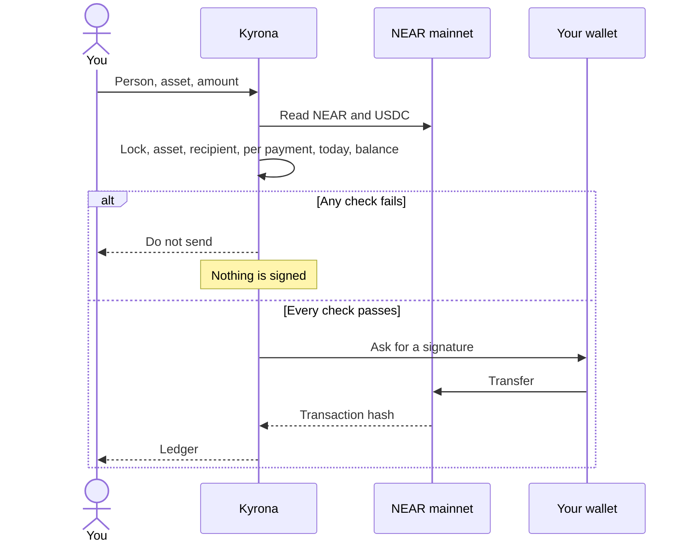

<p align="center">
  
</p>

<h1 align="center">Kyrona</h1>

<p align="center">
  Spending limits before you send NEAR or USDC.
</p>

<p align="center">
  <a href="https://kyrona.vercel.app"></a>
  
  
  <a href="LICENSE"></a>
</p>

<p align="center">
  <a href="https://kyrona.vercel.app">Open the desk</a>
  ·
  <a href="SECURITY.md">Security</a>
  ·
  <a href="CODE_OF_CONDUCT.md">Code of conduct</a>
  ·
  <a href="LICENSE">License</a>
</p>

Kyrona is a spending desk for a NEAR account. You name who you pay, set a cap per payment and a cap per day, and lock spending when you want everything to stop. Kyrona reads the real balance, runs those rules, and only then asks your wallet to sign. A failed check never opens a transfer.

## The problem

Sending NEAR is easy. Sending the wrong amount, to an account you did not mean, is also easy. A wallet asks you to approve a transaction. It does not know your daily budget, your list of people, or that you wanted spending frozen.

Kyrona sits in front of that approval.

## How a payment moves



The checks, in order:

| Check | Pass means |
|---|---|
| Spending lock | The desk is open |
| Asset | NEAR or USDC is allowed |
| Recipient | The account is on your list |
| Per payment | The amount is within that cap |
| Today | Today’s total would still be within the daily cap |
| Balance | The chain balance covers it |

## Proof

This is a real transfer, signed by the account that holds the funds. It is not a simulated hash.

[0.01 NEAR from `sithunyein.near` to `sithunyein.near`](https://nearblocks.io/txns/DmCpHhv7quFAzcB7dNwkSrdGXrPENMWJQqUCzTF8GC22)

The desk recorded that hash after the wallet confirmed it. A payment of 1 NEAR on the same account was refused first, because the balance was lower. No signature was requested for the refusal.

## Use it

The live desk is [kyrona.vercel.app](https://kyrona.vercel.app). Use Chrome and the [Meteor](https://meteorwallet.app) extension.

1. Choose **Connect**, then Meteor.
2. On Desk, choose **Refresh**. The figures come from the chain. Meteor may hide about 0.2 NEAR as its own gas reserve. The desk shows the full balance.
3. On Rules, add each account you pay. An account that is not on the list cannot be paid. Set the caps. **Locked** in the header stops every payment. **Open** means spending is allowed.
4. On Pay, choose the person, NEAR or USDC, and the amount. Choose **Check against my rules**.
5. **Do not send** means a check failed. Nothing is signed. **Save this stop** writes the refusal in the ledger.
6. **Safe to send** means every check passed. **Send on NEAR** opens the wallet. After you sign, the ledger stores the hash and the balance is read again.

**Save to my account** on Rules writes the limits and the ledger to `social.near`, signed by you, so the same wallet can load them in another browser. Until you do that, they stay on this phone or computer.

## What this is not

Say this plainly, because it is the boundary of the product.

- Kyrona does not hold keys and does not custody funds. Your wallet signs and broadcasts.
- The rules are enforced before Kyrona asks for a signature. A transfer started directly in the wallet is not checked.
- There is no cross-chain swap and no private computation.
- USDC can be sent only when the account actually holds USDC. If the recipient is not registered on the USDC contract, the same signature also pays that contract’s storage deposit.

## In the code

| Piece | Where |
|---|---|
| The six checks | [`src/lib/kyrona/engine.ts`](src/lib/kyrona/engine.ts) |
| Chain balances and USDC units | [`src/lib/kyrona/chain.ts`](src/lib/kyrona/chain.ts) |
| Wallet signature | [`src/lib/kyrona/wallet.ts`](src/lib/kyrona/wallet.ts) |
| Desk saved on `social.near` | [`src/lib/kyrona/account-desk.ts`](src/lib/kyrona/account-desk.ts) |
| The desk itself | [`src/routes/index.tsx`](src/routes/index.tsx) |

## Run it locally

```sh
npm install
npm run dev
```

The dev server is [http://127.0.0.1:8080](http://127.0.0.1:8080).

## Security

Report a vulnerability privately. Do not open a public issue for a live exploit. The threat model, what is signed, and what is not enforced on chain are in [SECURITY.md](SECURITY.md).

## Conduct

Be decent to the people using and building this. [CODE_OF_CONDUCT.md](CODE_OF_CONDUCT.md).

## License

[MIT](LICENSE). Copyright 2026 Sithu Nyein.
