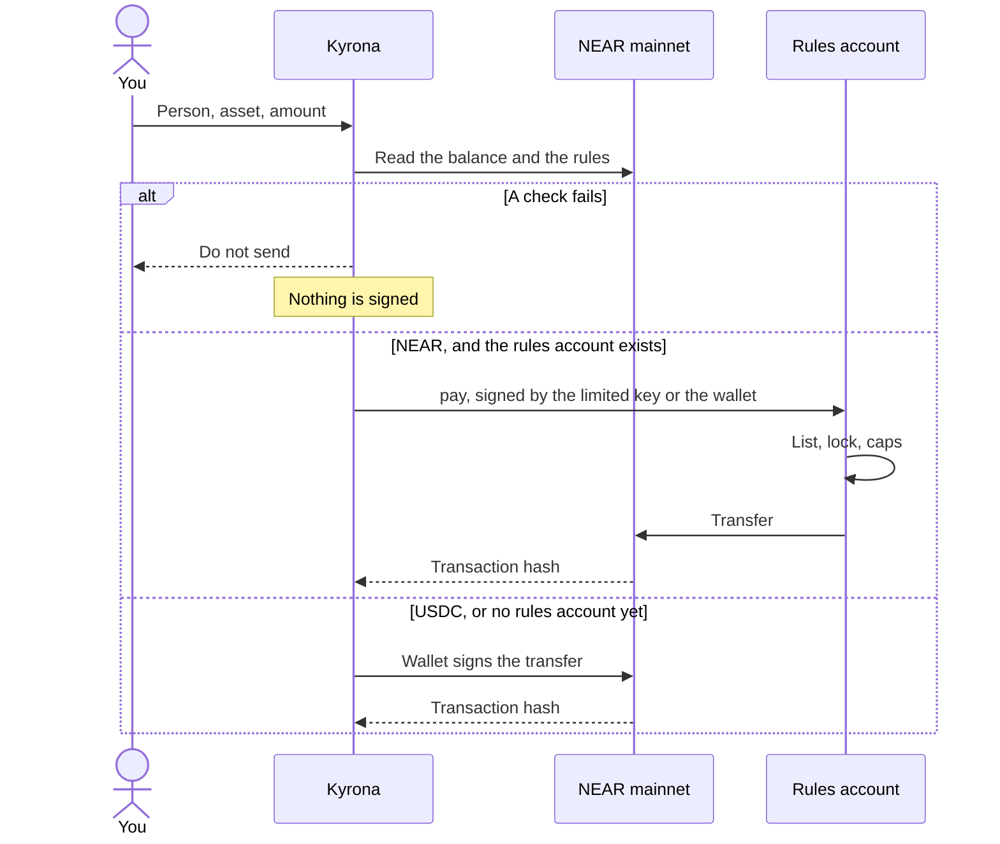

<p align="center">
  
</p>

<h1 align="center">Kyrona</h1>

<p align="center">
  Spending limits before you send NEAR or USDC.
</p>

<p align="center">
  <a href="https://kyrona.vercel.app"></a>
  
  <a href="https://nearblocks.io/address/rules.sithunyein.near"></a>
  <a href="LICENSE"></a>
</p>

<p align="center">
  <a href="https://kyrona.vercel.app">Open the desk</a>
  ·
  <a href="SECURITY.md">Security</a>
  ·
  <a href="CODE_OF_CONDUCT.md">Code of conduct</a>
  ·
  <a href="LICENSE">License</a>
</p>

Kyrona is a spending desk for a NEAR account. You name who you pay, set a cap per payment and a cap per day, and lock spending when you want everything to stop. For NEAR, those rules can live in their own account. A payment then has to call `pay`. The contract checks the list, the lock, and the caps, and only then sends the NEAR.


## The problem

Sending NEAR is easy. Sending the wrong amount, to an account you did not mean, is also easy. A wallet asks you to approve a transaction. It does not know your daily budget, your list of people, or that you wanted spending frozen.

Kyrona sits in front of that approval. Once the rules are on their own account, `pay` still checks them even if the page is skipped.

## How a payment moves



The checks, in order:

| Check | Pass means |
|---|---|
| Spending lock | The desk is open |
| Asset | NEAR or USDC is allowed |
| Recipient | The account is on your list |
| Per payment | The amount is within that cap |
| Today | Today’s total would still be within the daily cap |
| Balance | The chain balance covers it |

On the rules account, `pay` repeats the lock, the list, and both caps. USDC does not go through `pay`.

## Proof

`rules.sithunyein.near` is on mainnet. The owner is `sithunyein.near`. The list is that same account. The caps are 20 NEAR per payment and 50 NEAR a day. The lock is open.

A limited key on `sithunyein.near` can call `pay` and nothing else. Two attempts with that key failed, which is the point:

- Paying an account that is not on the list panicked in the contract: `Not on the list`.
- A direct transfer was rejected by the protocol. That key is not allowed to transfer.

The payment that passed is a real call to `pay`, not a transfer typed into the wallet:

[0.01 NEAR from `rules.sithunyein.near` to `sithunyein.near`](https://nearblocks.io/txns/EhiB269WNE8W823fJYvwRvB1ei9yHPXs6DrrbMYia9jd)

The contract recorded 0.01 NEAR spent today. The signer was `sithunyein.near`. The receiver of the call was `rules.sithunyein.near`.

## Use it

The live desk is [kyrona.vercel.app](https://kyrona.vercel.app). Meteor is a Chrome extension. MyNearWallet works in Firefox.

1. Choose **Connect**, then Meteor or MyNearWallet.
2. On Desk, choose **Refresh**. The figures come from the chain. Meteor may hide about 0.2 NEAR as its own gas reserve. The desk shows the full balance.
3. On Rules, add each account you pay. An account that is not on the list cannot be paid. Set the caps. **Locked** in the header stops every payment. **Open** means spending is allowed.
4. On Pay, choose the person, NEAR or USDC, and the amount. Choose **Check against my rules**.
5. **Do not send** means a check failed. Nothing is signed. **Save this stop** writes the refusal in the ledger.
6. **Safe to send** means every check passed. **Send on NEAR** opens the wallet, unless the rules are already on the account and this browser holds the limited key. Then the limited key calls `pay` and the wallet does not have to sign that payment.
7. On Rules, **Put the rules on chain** creates `rules.<your account>` and stores the list, the caps, and the lock there. Meteor will not deploy contract code, so that one signature can be made in the page. The key is not saved. About 0.79 NEAR moves. About 0.74 stays locked for the code. The rest can be paid out. **Add a limited key** creates a key that can call `pay` on that account and nothing else. **Try to break it** asks that key to pay an unknown account, and to transfer NEAR directly. Both must fail. **Update the rules** writes a new list or new caps. That one does open the wallet.

**Save to my account** on Rules writes the limits and the ledger to `social.near`, signed by you, so the same wallet can load them in another browser. Until you do that, they stay on this phone or computer.

## What this is not

- Kyrona does not custody a pool of funds. The rules account is a sub-account you still control. Your full-access key is on it, so you can move that NEAR without calling `pay`. The limited key cannot.
- Before the rules are on the account, they are enforced in the page. A transfer started directly in the wallet is not checked.
- USDC is checked in the page and sent with `ft_transfer`. It does not pass through `pay`.
- There is no cross-chain swap and no private computation.
- The rules account can pay out only the NEAR that is not locked for code. A large cap does not create a large balance.

## In the code

The desk is the product. The contract is the part a skipped page cannot bypass.

```text
kyrona
├── src
│   ├── routes
│   │   ├── index.tsx              Desk, Pay, Rules, Ledger
│   │   └── __root.tsx             Document, icon, theme
│   ├── lib
│   │   └── kyrona
│   │       ├── engine.ts          The six checks and the daily total
│   │       ├── policy.ts          The rules account, and reading it back
│   │       ├── chain.ts           Mainnet balance and USDC units
│   │       ├── wallet.ts          Wallet signature, deploy, limited key, pay
│   │       ├── account-desk.ts    Local desk and the social.near copy
│   │       ├── store.ts           Rules, balances, and the ledger
│   │       └── session.ts         Which account is connected
│   ├── router.tsx
│   ├── routeTree.gen.ts
│   └── styles.css
├── contract
│   ├── Cargo.toml                 near-sdk 5.17, so the wasm links on current mainnet
│   └── src/lib.rs                 list, caps, lock, pay
├── public
│   ├── kyrona.wasm                The contract the desk deploys, 73,784 bytes
│   ├── logo.png
│   ├── favicon.png
│   ├── favicon.svg
│   └── og.jpg
├── docs
│   └── desk.png                   The desk, before a wallet is connected
├── README.md
├── SECURITY.md
├── CODE_OF_CONDUCT.md
├── LICENSE
├── package.json
├── tsconfig.json
├── vite.config.ts
└── vercel.json
```

A newer SDK imported host functions this network does not provide. The contract is pinned to `near-sdk` 5.17 so `pay` can start. A transfer is decided in `engine.ts`, and signed in `wallet.ts`. On chain, `contract/src/lib.rs` decides it again.

## Run it locally

```sh
npm install
npm run dev
```

The dev server is [http://127.0.0.1:8080](http://127.0.0.1:8080).

## Security

Report a vulnerability privately. Do not open a public issue for a live exploit. The threat model, what is signed, and what is not enforced on chain are in [SECURITY.md](SECURITY.md).

## Conduct

Be decent to the people using and building this. [CODE_OF_CONDUCT.md](CODE_OF_CONDUCT.md).

## License

[MIT](LICENSE). Copyright 2026 Sithu Nyein.
